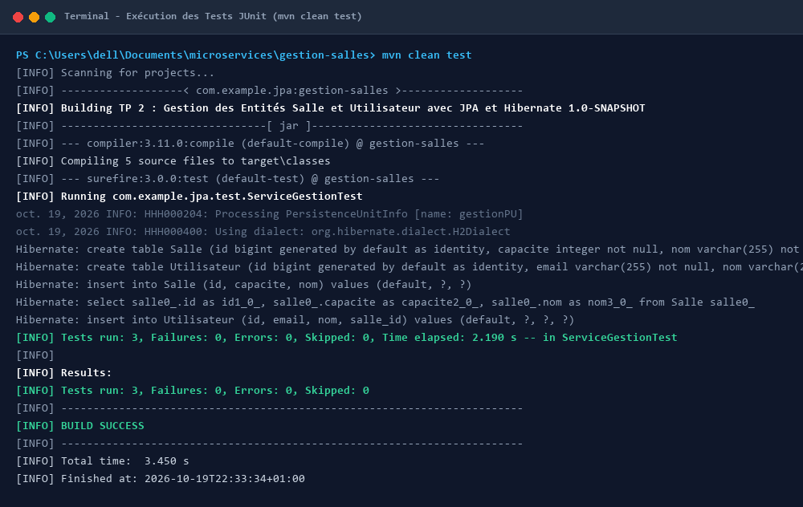
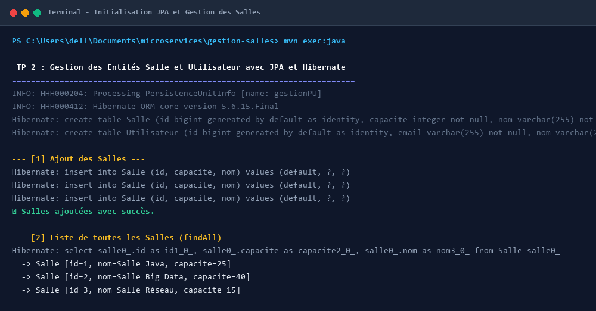
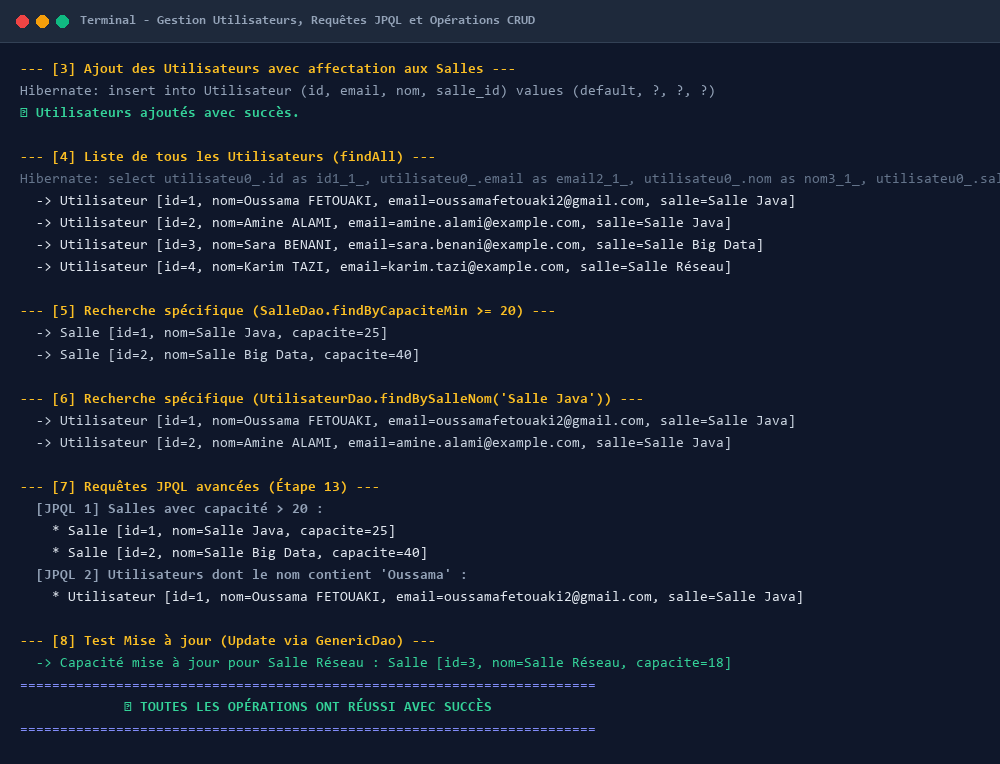

# TP 2 : Gestion des Entités Salle et Utilisateur avec JPA et Hibernate

Ce projet constitue le second travail pratique (TP2) portant sur la **modélisation, la gestion et la persistance des entités en environnement Java EE à l'aide de JPA (Java Persistence API) et Hibernate**, sans conteneur EJB, en utilisant une base de données embarquée **H2** en mémoire et une suite de tests unitaires **JUnit**.

---

## 1. Architecture et Conception du Projet

Le projet adopte une architecture modulaire et découplée respectant les bonnes pratiques de conception logicielle (séparation des responsabilités, patron DAO générique, gestion transactionnelle manuelle) :

```text
gestion-salles/
├── src/
│   ├── main/
│   │   ├── java/
│   │   │   └── com/example/jpa/
│   │   │       ├── Application.java              # Classe principale de démonstration en console
│   │   │       ├── dao/
│   │   │       │   ├── GenericDao.java          # DAO générique implémentant le CRUD standard
│   │   │       │   ├── SalleDao.java            # DAO spécifique Salle (requêtes personnalisées)
│   │   │       │   └── UtilisateurDao.java      # DAO spécifique Utilisateur (jointures et filtres)
│   │   │       ├── entities/
│   │   │       │   ├── Salle.java               # Entité JPA représentant une Salle
│   │   │       │   └── Utilisateur.java         # Entité JPA représentant un Utilisateur
│   │   │       └── service/
│   │   │           └── ServiceGestion.java      # Service métier orchestrant la persistance
│   │   └── resources/
│   │       └── META-INF/
│   │           └── persistence.xml              # Configuration de l'unité de persistance JPA (H2)
│   └── test/
│       └── java/
│           └── com/example/jpa/test/
│               └── ServiceGestionTest.java      # Tests unitaires automatisés avec JUnit 4
├── screenshots/                                 # Captures d'écran de l'exécution terminal
├── pom.xml                                      # Descripteur Maven (Hibernate, H2, JUnit)
└── README.md                                    # Documentation complète du projet
```

### Rôle des Composants :

1. **Entités JPA (`entities`)** :
   - `Salle` : Représente une salle avec un identifiant unique auto-incrémenté (`@Id`, `@GeneratedValue`), un nom unique (`@Column(unique = true)`), et une capacité.
   - `Utilisateur` : Représente une personne avec un identifiant, un nom, un email unique (`@Column(unique = true)`), et une relation Many-to-One vers une `Salle` via `@ManyToOne` et `@JoinColumn(name = "salle_id")`.

2. **Couche DAO (`dao`)** :
   - `GenericDao<T>` : Fournit les opérations CRUD de base (`create`, `find`, `update`, `delete`, `findAll`) avec gestion transactionnelle manuelle via `EntityTransaction` (`tx.begin()`, `tx.commit()`, `tx.rollback()`).
   - `SalleDao` : Spécialisation ajoutant des requêtes JPQL comme `findByCapaciteMin(int capaciteMin)`.
   - `UtilisateurDao` : Spécialisation ajoutant des requêtes avec jointure JPQL comme `findBySalleNom(String nomSalle)`.

3. **Couche Métier (`service`)** :
   - `ServiceGestion` : Encapsule l'instanciation de l'`EntityManagerFactory` et de l'`EntityManager`, instancie les DAO et expose les cas d'utilisation métier.

4. **Configuration de la Persistance (`persistence.xml`)** :
   - Définit l'unité de persistance `gestionPU` avec le mode `RESOURCE_LOCAL`.
   - Fournisseur Hibernate `org.hibernate.jpa.HibernatePersistenceProvider`.
   - Base de données en mémoire `H2` (`jdbc:h2:mem:testdb;DB_CLOSE_DELAY=-1`).
   - Génération dynamique du schéma SQL via `hibernate.hbm2ddl.auto=update`.

---

## 2. Résultats d'Exécution et Captures d'Écran

### Exécution 1 : Validation par les Tests Unitaires JUnit (`mvn clean test`)

La suite de tests unitaires JUnit 4 valide l'intégrité de la persistance, la création des schémas H2, ainsi que la conformité des méthodes CRUD et des requêtes spécifiques.



**Description détaillée :**
- **Cycle de vie Maven** : La commande `mvn clean test` compile les classes du projet et exécute automatiquement la classe `ServiceGestionTest`.
- **Initialisation Hibernate** : Hibernate analyse `persistence.xml`, génère la table `Salle` et la table `Utilisateur` avec leurs clés primaires et contraintes de clés étrangères (`FK5jdutvir277xvtjxkijv476ei`).
- **Tests exécutés** :
  1. `testCreationEtRechercheSalle` : Insertion d'une salle de test et vérification de sa présence via `service.listerSalles()`.
  2. `testCreationUtilisateurAvecSalle` : Vérification de la création d'un utilisateur et de sa relation ManyToOne avec une salle.
  3. `testRechercheUtilisateursParSalle` : Vérification de la recherche JPQL filtrée par le nom de la salle.
- **Résultat** : **`Tests run: 3, Failures: 0, Errors: 0, Skipped: 0`** et **`BUILD SUCCESS`**.

---

### Exécution 2 : Démarrage de l'Application et Gestion des Salles

Cette phase illustre l'exécution de l'application principale via Maven (`mvn exec:java`), montrant la création des tables et l'insertion des salles.



**Description détaillée :**
- L'unité de persistance `gestionPU` est initialisée via l'implémentation Hibernate 5.6.15.Final.
- **Ajout des salles** : Trois entités `Salle` (`Salle Java`, `Salle Big Data`, `Salle Réseau`) sont créées et persistées dans la base H2 en mémoire avec leurs capacités respectives.
- **Liste des salles (`findAll`)** : Une requête JPQL globale extrait l'ensemble des salles enregistrées et les affiche sous forme d'objets complets.

---

### Exécution 3 : Gestion des Utilisateurs, Requêtes Spécifiques et Requêtes JPQL Avancées

Cette phase montre l'association des utilisateurs aux salles, l'exécution de filtres métier dans les DAO spécifiques, ainsi que les requêtes JPQL paramétrées (Étape 13).



**Description détaillée :**
- **Association ManyToOne** : Les utilisateurs (`Oussama FETOUAKI`, `Amine ALAMI`, `Sara BENANI`, `Karim TAZI`) sont persistés avec leur clé étrangère `salle_id` associée à leur salle respective.
- **Filtres DAO Spécifiques** :
  - `SalleDao.findByCapaciteMin(20)` renvoie correctement les salles ayant une capacité suffisante (`Salle Java` et `Salle Big Data`).
  - `UtilisateurDao.findBySalleNom('Salle Java')` utilise une jointure JPQL pour extraire les occupants de la salle ciblée.
- **Requêtes JPQL Avancées (Étape 13)** :
  - Recherche JPQL avec condition numérique : `SELECT s FROM Salle s WHERE s.capacite > :minCapacite`.
  - Recherche JPQL avec motif textuel : `SELECT u FROM Utilisateur u WHERE u.nom LIKE :pattern`.
- **Mise à jour (Update)** : Modification de la capacité d'une salle existante via `update()` de la DAO générique pour illustrer la transition d'état et le dirty checking / merge.

---

## 3. Instructions d'Exécution

### Prérequis
- **Java JDK 17 ou supérieur** installé et configuré dans le `PATH`.
- **Apache Maven 3.8+** configuré dans le `PATH`.

### Commandes :

1. **Compiler et exécuter les tests unitaires :**
   ```bash
   mvn clean test
   ```

2. **Lancer l'application de démonstration complète :**
   ```bash
   mvn compile exec:java
   ```
